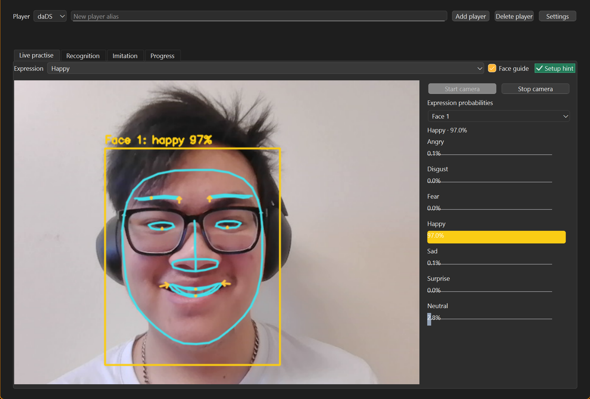
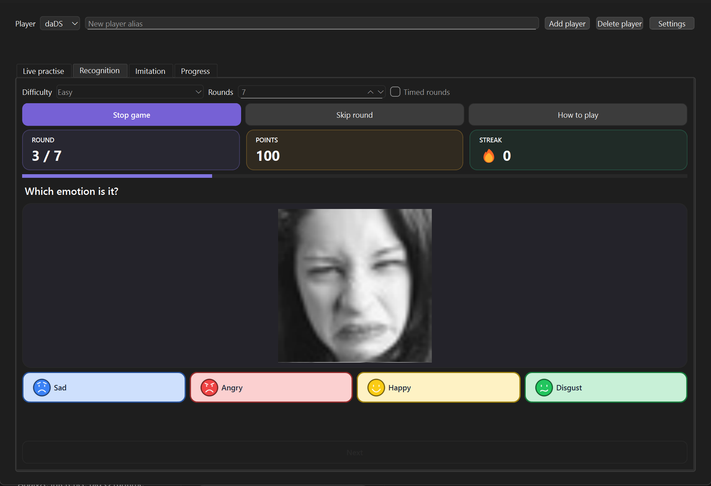
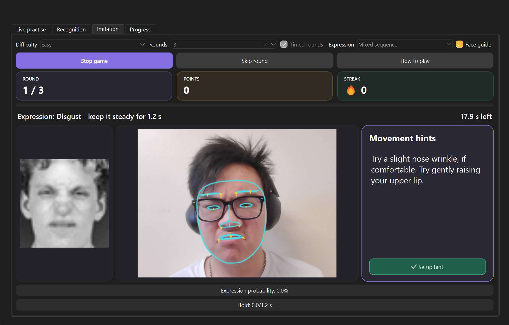

# Facial Expression Practise Game

A computer vision-based desktop game for practising facial expression recognition and imitation.

[Technical Details](output/technical_details.md) | [Training Results](output/training_results.md)







## Setup

```text
python -m pip install uv==0.6.5
uv venv --python 3.12.9
uv pip sync requirements.lock --require-hashes
```

### Models

Download `models.zip` from [Releases](../../releases) and extract it into the project root.

Windows:

```powershell
Expand-Archive "$HOME\Downloads\models.zip" -DestinationPath . -Force
```

Linux:

```bash
unzip ~/Downloads/models.zip -d .
```

```text
results/onnx/resnet18_fp32.onnx
results/onnx/resnet18_fp32.onnx.json
results/models/face_landmarker_v1.task
```

## Run

Windows:

```powershell
.\scripts\run.cmd app --mode live
```

Linux:

```bash
PYTHONPATH=src .venv/bin/python -m cli app --mode live
```

Add a player to enable the tabs. For Recognition and Imitation, open **Settings > Import my images** and choose a folder with expression-named subfolders: `angry`, `disgust`, `fear`, `happy`, `sad`, `surprise`, `neutral`. For FER2013 references, place the dataset in `data/FER2013/` and click **Settings > Prepare FER2013 images**; inspection runs automatically.

## Limitations

- FER2013 reference images come from the grayscale training set and may show expressions unclearly. Importing your own reference images is recommended.
- Accuracy varies, and misclassifications remain frequent in webcam use, particularly for neutral and disgust expressions. Future work could explore more robust models.

## Training (optional)

Place FER2013 in `data/FER2013/`. Training outputs go to `results/`.

```powershell
.\scripts\run.cmd audit --data data/FER2013
.\scripts\run.cmd train --config "<config_path>"
```

[Experiments](experiments/README.md) contains benchmarks and result summaries, separate from app startup and training.

### CUDA (optional)

```text
uv pip sync requirements.cuda.lock --require-hashes
```

### WSL share workaround (Windows)

```powershell
uv venv "$env:LOCALAPPDATA\fer-venv" --python 3.12.9
$env:FER_PYTHON = "$env:LOCALAPPDATA\fer-venv\Scripts\python.exe"
uv pip sync requirements.lock --python "$env:FER_PYTHON" --require-hashes
$env:FER_TRACKING_DIR = "$env:LOCALAPPDATA\fer-mlruns"
$env:FER_GAME_DIR = "$env:LOCALAPPDATA\fer-game"
.\scripts\run.cmd app --mode imitation
```
