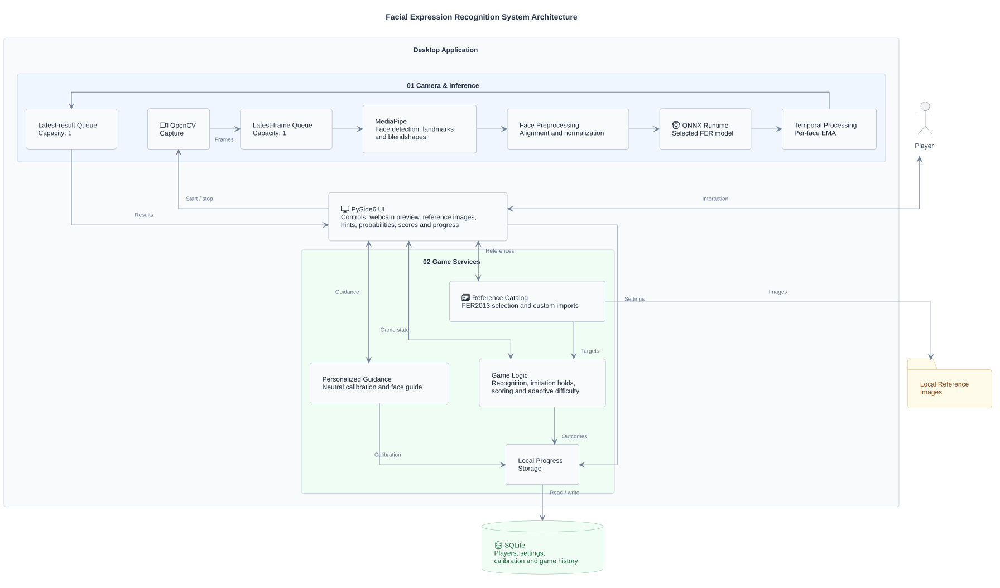
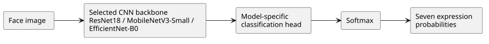

# Technical details

[Setup](../README.md#setup) | [Training results](training_results.md)

## App

Capture and inference run on separate threads with single-item queues.

## Models

Seven classes: angry, disgust, fear, happy, sad, surprise, neutral. The app runs one selected ONNX export at a time.

### CNN models

The backbone and head are fine-tuned together from ImageNet initialization.

| Model | Features entering head | Classification head |
| --- | --- | --- |
| ResNet18 | 512 | Linear(512, 7) |
| MobileNetV3-Small | 576 | Linear(576, 1024) -> Hardswish -> Dropout(0.2) -> Linear(1024, 7) |
| EfficientNet-B0 | 1,280 | Dropout(0.2) -> Linear(1280, 7) |

[Preprocessing, training settings and scores](training_results.md). Deployment selects the fastest eligible model within 0.03 of the best validation macro-F1.

## Key files

| File | Purpose |
| --- | --- |
| `src/cli.py` | App and experiment commands. |
| `src/ui/app.py`, `game_hub.py` | Main window, camera controls, game tabs and settings. |
| `src/inference/webcam.py` | Capture, face processing and bounded queues. |
| `src/inference/landmarks.py`, `backends.py`, `temporal.py` | MediaPipe, model inference and EMA smoothing. |
| `src/data/preprocessing.py` | Shared image normalization for training and inference. |
| `src/games/recognition.py`, `imitation.py` | Round state, answers, hold checks and scoring. |
| `src/games/feedback.py`, `face_guide.py` | Neutral calibration, movement hints and guide geometry. |
| `src/games/progress.py` | SQLite players, settings, calibration and history. |
| `src/games/catalog.py`, `custom_references.py` | FER2013 references and custom-image imports. |
| `src/models/cnn.py` | CNN backbones and classification heads. |
| `src/training/cnn.py`, `fusion.py` | CNN and feature-classifier training. |
| `src/deployment/onnx.py` | ONNX export and precision conversion. |
| `scripts/package_models.py` | Package existing app models, notices and checksums for a GitHub Release. |
| `src/evaluation/plot_utils.py` | Reusable training, evaluation and comparison plots; shared styling and SVG/PNG export. |
| `experiments/run.py`, `utils.py` | Saved-result summaries, benchmark plots and architecture diagrams. |
| `experiments/scripts/` | Seed sweeps and performance measurements. |
| `configs/*.json` | Training parameters and local artifact paths. |
| `requirements.lock`, `requirements.cuda.lock` | Exact CPU/default and CUDA dependency environments. |

## Tech stack

| Role | Libraries / versions |
| --- | --- |
| Runtime / UI | Python 3.12.9, PySide6 6.8.2.1 |
| Camera / landmarks | OpenCV contrib/headless 4.11.0.86, MediaPipe 0.10.21 |
| Images / arrays | Pillow 11.1.0, NumPy 1.26.4 |
| Models / training | PyTorch 2.6.0, torchvision 0.21.0, Albumentations 2.0.5 |
| Export / inference | ONNX 1.17.0, ONNX Runtime 1.21.0 |
| Evaluation / analysis | scikit-learn 1.6.1, Pandas 2.2.3, SciPy 1.15.2 |
| Experiment tracking | MLflow 2.20.3 |
| Local storage | SQLite 3.47.1 via Python sqlite3 in the pinned Windows runtime |
| Figures / diagrams | Matplotlib 3.10.1, Seaborn 0.13.2, SciencePlots 2.1.1, Graphviz 0.20.3 |
| Resource profiling | psutil 7.0.0 |
| Testing / lint | pytest 8.3.5, Ruff 0.9.10 |
| Environment / packaging | uv 0.6.5, setuptools 75.8.0 |
